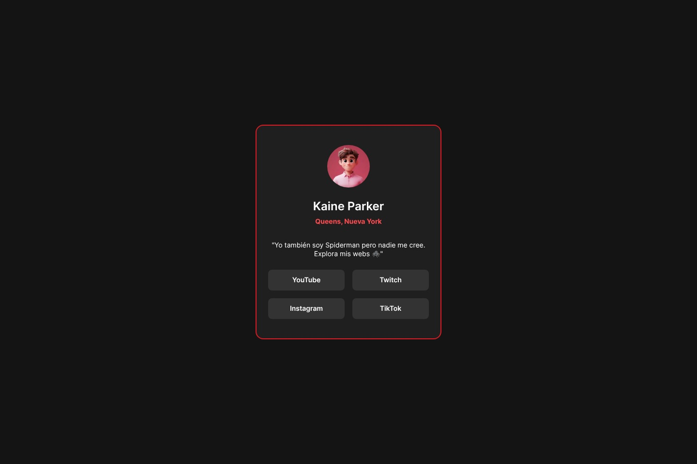

# Perfil de enlaces de Kaine Parker

## Contexto

Kaine Parker es un creador de contenido (ficticio) fan de Spider-Man que quiere una página sencilla donde sus seguidores encuentren todas sus redes sociales en un solo sitio, al estilo de las páginas de "enlaces en la bio". Tu trabajo es maquetar esa página.

Este proyecto es la prueba de recuperación del RA1 de Desarrollo Web inicial («Crea interfaces web homogéneos definiendo y aplicando estilos»).

**Para hacer este proyecto necesitas conocimientos básicos de HTML y CSS.**

## El reto

Debes construir el perfil de enlaces de Kaine Parker y dejarlo lo más parecido posible al diseño de la carpeta `/design`.

Puedes usar el editor y las herramientas del navegador que quieras. No se permiten frameworks ni librerías de CSS (Bootstrap, Tailwind, etc.) ni JavaScript: el objetivo es practicar HTML y CSS puros.

Los usuarios de la página deben poder:

- Ver el perfil de Kaine: foto, nombre, ubicación y frase de presentación.
- Acceder a sus cuatro redes (YouTube, Twitch, Instagram y TikTok) mediante enlaces con aspecto de botón, **colocados en dos filas y dos columnas**.
- Ver los estados *hover* y *focus* de todos los elementos interactivos de la página.
- Usar la página cómodamente tanto en móvil como en escritorio.

Fíjate también en los detalles del diseño: la tarjeta lleva un **borde rojo** y la paleta solo usa rojos y grises.

## Dónde encontrar todo

- `/design`: diseños de referencia en JPG (versión móvil, versión escritorio y estados activos). Al ser imágenes estáticas, tendrás que usar tu criterio para estilos como `font-size`, `padding` y `margin`.
- `/assets`: imágenes y fuentes necesarias. La foto de Kaine es `assets/images/kaine_parker.webp`. Ya están exportadas y optimizadas. Se incluyen las fuentes de Inter (variable y estáticas); puedes enlazarlas desde Google Fonts o alojarlas tú mismo con los archivos locales.
- `style-guide.md`: colores, tipografía y anchos de diseño.
- `index.html`: punto de partida con el contenido ya escrito. Tu trabajo es estructurarlo con HTML semántico y darle estilo con CSS.
- `/Asimov`: protocolo de uso de la IA en este proyecto (ver más abajo).

## Requisitos técnicos

1. HTML5 semántico (`main`, `h1`, `ul`/`li`, `a`, `img` con `alt`, etc.) y jerarquía de encabezados correcta.
2. CSS en un archivo aparte enlazado desde `index.html`.
3. Diseño adaptable (*responsive*) entre 320px y pantallas grandes.
4. Los cuatro enlaces se organizan en una cuadrícula de dos columnas (se recomienda CSS Grid).
5. Estados `:hover` y `:focus-visible` visibles en todos los enlaces.
6. Paleta de colores solo con rojos y grises: ningún azul, ni siquiera el de los enlaces por defecto.
7. Contraste de color suficiente y navegación completa con teclado.
8. Código validado sin errores en el validador de HTML del W3C (https://validator.w3.org/).

## Uso de la IA: Protocolo Asimov

Si usas un asistente de IA, debes hacerlo siguiendo el **Protocolo Asimov**, que está en la carpeta `/Asimov`:

- `Asimov/AGENTS.md`: reglas que debe cumplir la IA (actúa como tutor, no te da la solución).
- `Asimov/PROMPT_INICIAL.md`: mensaje con el que debes abrir la conversación con la IA, adjuntando `AGENTS.md`.
- `Asimov/PROMPT_CIERRE.md`: mensaje con el que, al terminar, pedirás a la IA el archivo `CONVERSACION.md`.

Al entregar, `CONVERSACION.md` debe acompañar a tu proyecto. Su ausencia, alteración u omisiones no declaradas se consideran incumplimientos críticos.

## Cómo construir tu proyecto

Puedes seguir el flujo que prefieras. Te proponemos este:

1. Mira el diseño y planifica cómo vas a abordarlo: qué elementos se repiten y qué clases CSS podrás reutilizar.
2. Antes de añadir estilos, estructura el contenido con HTML.
3. Escribe los estilos base: `font-family`, `font-size`, colores y fondo.
4. Empieza a dar estilo desde la parte superior de la tarjeta y baja poco a poco. No pases a la siguiente sección hasta estar contento con la actual.
5. Añade los estados *hover* y *focus*.
6. Prueba la página en distintos anchos y valida el HTML.

## Entrega

Entrega la carpeta completa del proyecto (con `index.html`, tu CSS, `assets/` y `CONVERSACION.md`) por el medio que indique tu docente. Puedes sustituir este `README.md` por uno propio usando `README-plantilla.md`.
